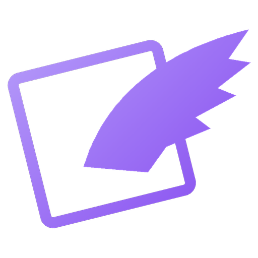

<h1 align="center">AveriStrap</h1>

<p align="center">
    
</p>

<p align="center">Lanzador de Roblox para Windows, oscuro y en morado.</p>

## Descargar

Descarga el instalador desde la [última versión](https://github.com/AlonsoSilvaDev/Strap/releases/latest) o desde la [web](https://averistrap.pages.dev).

Requiere Windows 10 u 11. El programa no está firmado, así que Windows puede mostrar «Windows protegió su PC»: pulsa *Más información* y luego *Ejecutar de todas formas*.

Descarga AveriStrap solo desde este repositorio o desde la web.

## Qué hace

- Mantiene Roblox actualizado y lo abre desde el navegador.
- FastFlags con perfiles.
- Mods de la comunidad, varios a la vez, y generador de mods.
- Juego rápido y selector de región.
- BetterMatchmaking (opcional).
- Ajustes de Roblox y apariencia de la app.

La galería de cielos de la comunidad de las versiones 1.1.4 y anteriores todavía no está disponible.

## Compilar

Necesitas .NET 10, Rust nightly y los submódulos.

```powershell
git clone --recurse-submodules https://github.com/AlonsoSilvaDev/Strap.git
```

```powershell
dotnet build AveriStrap\AveriStrap.csproj -c Debug
```

## Créditos y licencia

AveriStrap está basado en [Froststrap](https://github.com/Froststrap/Froststrap), que deriva de [Fishstrap](https://github.com/fishstrap/fishstrap) y [Bloxstrap](https://github.com/bloxstraplabs/bloxstrap).

El código heredado se distribuye bajo la [Mozilla Public License 2.0](https://mozilla.org/MPL/2.0/) y pertenece a sus autores. El nombre y el logo de AveriStrap se rigen por [LICENSE-AveriStrap.txt](LICENSE-AveriStrap.txt).

No está afiliado a Roblox Corporation.
